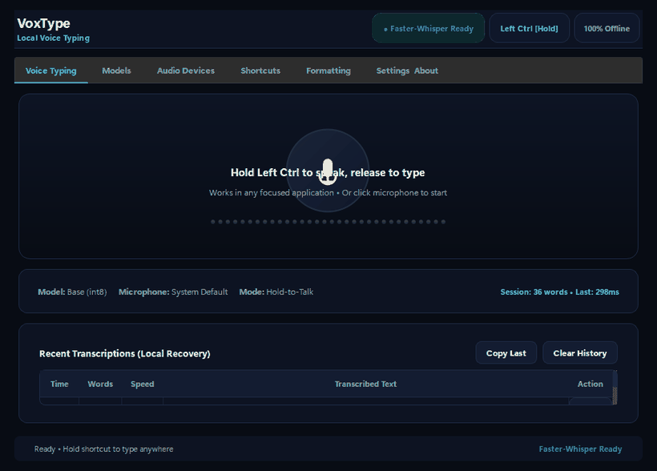
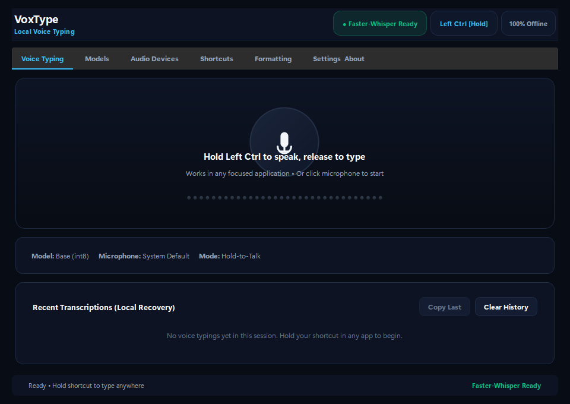
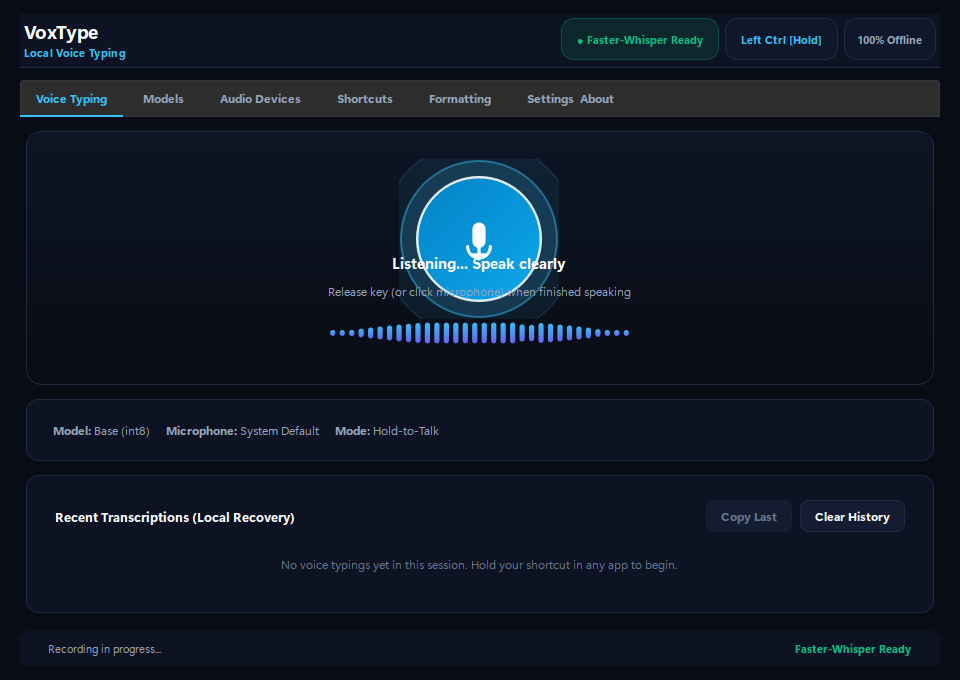
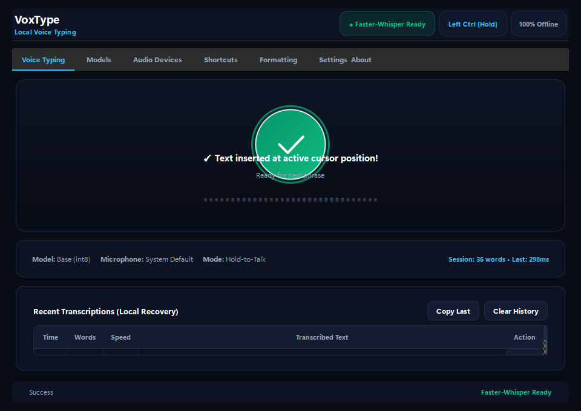
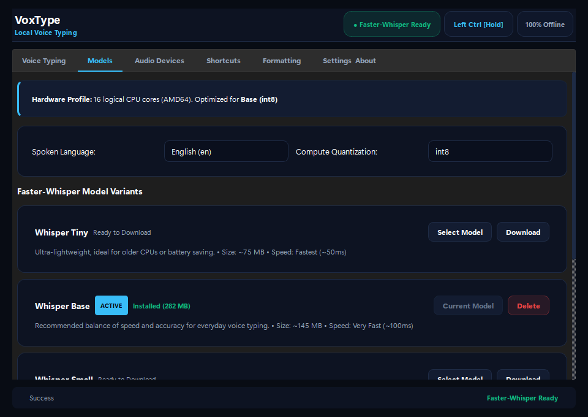
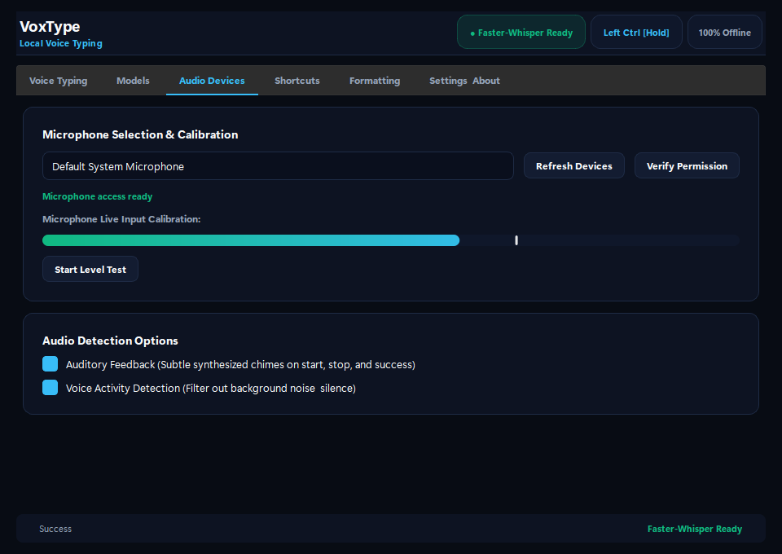
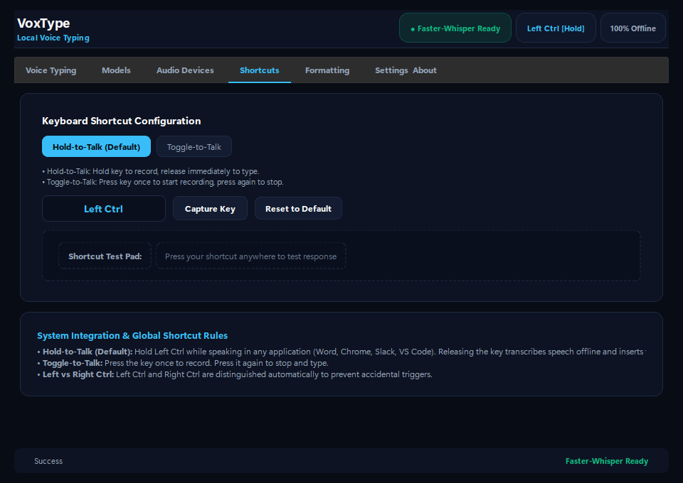
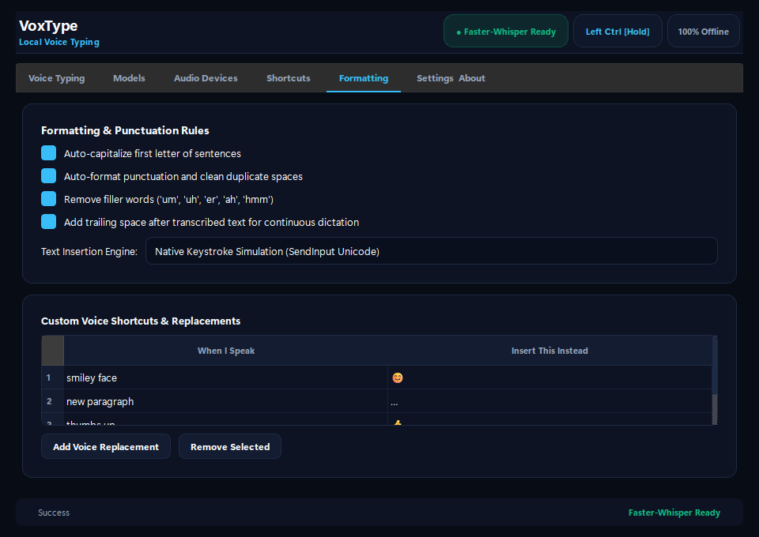
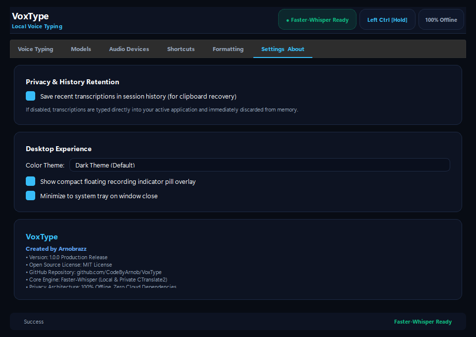
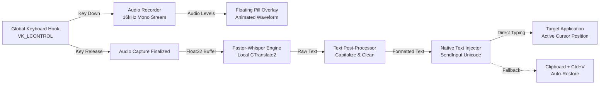

<div align="center">

# VoxType
### Local Voice Typing

[](https://github.com/CodeByArnob/VoxType/releases)
[](https://www.python.org/)
[](https://github.com/SYSTRAN/faster-whisper)
[](#privacy--security-architecture)
[](LICENSE)

<p align="center">
  A lightweight, open-source desktop voice typing application powered by local <b>Faster-Whisper</b> speech recognition.<br/>
  Dictate text into any focused desktop application with sub-second latency, zero cloud dependencies, and true push-to-talk convenience.
</p>

---



</div>

---

## Table of Contents

- [Overview](#overview)
- [Key Features](#key-features)
- [Interface Showcase](#interface-showcase)
- [Architecture & Workflow](#architecture--workflow)
- [Getting Started](#getting-started)
  - [Prerequisites](#prerequisites)
  - [Installation](#installation)
  - [Running VoxType](#running-voxtype)
- [Keyboard Shortcut System](#keyboard-shortcut-system)
- [Local Whisper Model Management](#local-whisper-model-management)
- [Audio Calibration & Device Selection](#audio-calibration--device-selection)
- [Text Formatting & Custom Replacements](#text-formatting--custom-replacements)
- [Privacy & Security Architecture](#privacy--security-architecture)
- [Automated Testing](#automated-testing)
- [Troubleshooting](#troubleshooting)
- [Contributing](#contributing)
- [License & Credits](#license--credits)

---

## Overview

**VoxType** brings fluid, push-to-talk voice typing to your entire operating system. Inspired by modern speech workflows, it enables you to hold your preferred shortcut key (defaulting to **Left Ctrl**) anywhere—in VS Code, Slack, Word, browsers, terminal windows, or note-taking apps—speak naturally, and have your spoken words transcribed locally and injected directly at your active text cursor.

Unlike web-based or subscription dictation tools, VoxType performs **100% of audio capture, processing, and transcription locally on your machine**. Your voice recordings never leave your device, no network requests are made during dictation, and no accounts or API keys are required.

---

## Key Features

- **⚡ True Push-to-Talk Dictation:** Hold **Left Ctrl** to speak, release to type. Or switch to **Toggle-to-Talk** (press once to record, press again to transcribe).
- **🎯 Physical Key Discrimination:** Explicitly distinguishes physical **Left Ctrl** (`VK_LCONTROL = 162`) from **Right Ctrl** (`VK_RCONTROL = 163`) to prevent accidental triggers during normal modifier usage.
- **🔒 Complete Local Privacy:** Powered by local Faster-Whisper (CTranslate2). Zero audio data is transmitted across networks.
- **🖥️ Universal Text Injection:** Types directly into whichever application has focus via Win32 `SendInput` Unicode keystrokes, with non-destructive clipboard-and-paste fallback.
- **🪄 Floating Status Overlay:** Non-focus-stealing floating pill showing live animated waveform feedback, real-time stopwatch, and latency metrics.
- **📦 In-App Whisper Model Manager:** Download, switch, and manage Whisper models (`tiny`, `base`, `small`, `medium`, `large-v3`) with progress bars and cancellation support.
- **⚙️ Hardware-Aware Threading:** Automatically profiles available CPU logical cores and configures optimal intra-threads and compute quantization (`int8`, `float32`).
- **🎙️ Microphone Calibration & VU Meter:** Live audio input monitor with permission checks and automatic audio-device reconnect fallback.
- **🔤 Smart Text Post-Processing:** Auto-capitalization, punctuation correction, filler word elimination (*"um"*, *"uh"*, *"ah"*), and custom user voice shortcuts.
- **🎨 Refined Dark-First Desktop UI:** Built on PySide6 (Qt) featuring high-contrast typography, 60 FPS animated microphone controls, and zero clutter.

---

## Interface Showcase

| Voice Typing (Idle) | Active Push-to-Talk (Waveform) |
| :---: | :---: |
|  |  |

| Transcription Completed & Recovery Log | Local Faster-Whisper Model Variants |
| :---: | :---: |
|  |  |

| Audio Devices & Live VU Calibration | Global Shortcut Customization Pad |
| :---: | :---: |
|  |  |

| Formatting Rules & Custom Shortcuts | Settings, History Retention & About |
| :---: | :---: |
|  |  |

### Floating Recording Indicator

The compact overlay pill appears seamlessly on screen without stealing focus from your target application:

| Listening State | Transcribing State | Completed State |
| :---: | :---: | :---: |
|  |  |  |

---

## Architecture & Workflow



1. **Global Shortcut Hook:** A background keyboard monitor listens for key press and release events, tracking whether Left Ctrl or another custom combination is held.
2. **Audio Capture:** When triggered, a 16 kHz mono float32 audio stream begins recording microphone input while computing live RMS audio energy for the waveform.
3. **Inference Execution:** Upon key release, audio frames are handed off to the local Faster-Whisper worker thread without blocking the GUI.
4. **Text Formatting:** The transcribed text is normalized, capitalized, stripped of filler words, and matched against custom phrase replacements.
5. **Universal Injection:** The window manager verifies target application focus via `GetForegroundWindow` / `SetForegroundWindow` and types the text natively via `SendInput`.

---

## Getting Started

### Prerequisites

- **Operating System:** Windows 10 / 11 (64-bit) or Linux (Ubuntu 22.04+)
- **Python:** Version 3.10, 3.11, or 3.12 (64-bit)
- **Audio:** Working microphone or audio input device

### Installation

1. **Clone the repository:**
   ```bash
   git clone https://github.com/CodeByArnob/VoxType.git
   cd VoxType
   ```

2. **Create and activate a virtual environment:**
   ```bash
   # Windows (PowerShell / Command Prompt)
   python -m venv .venv
   .venv\Scripts\activate

   # Linux / macOS
   python3 -m venv .venv
   source .venv/bin/activate
   ```

3. **Install the package and dependencies:**
   ```bash
   pip install --upgrade pip
   pip install -e .
   ```

### Running VoxType

Launch the application using either command:

```bash
python run.py
# or via entrypoint:
voxtype
```

Upon initial launch, VoxType automatically loads the lightweight **Base** model (or downloads it if not yet cached).

---

## Keyboard Shortcut System

VoxType provides an intelligent global keyboard hook that works reliably across the entire operating system, even when minimized to the system tray.

### Recording Modes

| Mode | Behavior | Best Used For |
| :--- | :--- | :--- |
| **Hold-to-Talk** *(Default)* | Hold down the key to record; releasing immediately stops recording and types text. | Short phrases, commands, rapid sentence dictation. |
| **Toggle-to-Talk** | Press once to start recording; press a second time to stop and type. | Long paragraphs, speeches, hands-free dictation. |

### Modifier Discrimination

Many applications suffer from modifier conflicts when using Ctrl as a shortcut. VoxType distinguishes:
- **Left Ctrl (`VK_LCONTROL = 162`):** Primary push-to-talk key.
- **Right Ctrl (`VK_RCONTROL = 163`):** Left unaffected for standard browser or editor shortcuts.

You can customize the shortcut to any key (e.g., `F8`, `F9`, `Ctrl+Space`, `Alt+V`) in the **Shortcuts** tab using the interactive key recorder.

---

## Local Whisper Model Management

VoxType supports multiple Faster-Whisper model variants depending on your hardware:

| Model Variant | Local Disk Size | RAM Required | Latency Profile | Accuracy | Recommendation |
| :--- | :---: | :---: | :---: | :---: | :--- |
| **Tiny** | ~75 MB | ~500 MB | Ultra-fast (<200ms) | Good | Low-power laptops / older CPUs |
| **Base** *(Default)* | ~145 MB | ~800 MB | Fast (~300ms) | Very Good | Balanced everyday voice typing |
| **Small** | ~480 MB | ~1.5 GB | Moderate (~600ms) | High | Detailed technical dictation |
| **Medium** | ~1.5 GB | ~3.5 GB | Slower (~1.2s) | Excellent | Multilingual & complex vocabulary |
| **Large-v3** | ~3.1 GB | ~6.0 GB | Heavy (~2.5s) | Best in Class | Maximum accuracy on high-end hardware |

All models are downloaded directly from the official HuggingFace repository to `%APPDATA%/VoxType/models/` and can be canceled, updated, or removed from the **Models** tab at any time.

---

## Audio Calibration & Device Selection

- **Microphone Selection:** Easily switch between internal microphones, USB audio interfaces, and headsets without restarting the app.
- **Live VU Meter:** Monitor microphone input volume in real time to verify signal clarity before dictating.
- **Permission Diagnostics:** Integrated one-click permission check ensures your operating system grants audio access to Python.
- **Auditory Feedback:** Optional synthesized chimes provide subtle audio cues on recording start, stop, and successful transcription.

---

## Text Formatting & Custom Replacements

Fine-tune how your speech is processed before insertion:

- **Auto-Capitalization:** Automatically capitalizes the first letter of sentences.
- **Smart Punctuation:** Cleans duplicate whitespace, normalizes question marks and periods.
- **Filler Word Filter:** Automatically eliminates spoken fillers such as *"um"*, *"uh"*, *"er"*, and *"ah"*.
- **Custom Voice Shortcuts:** Define custom triggers to expand phrases or emojis:
  - *"smiley face"* ➔ `😊`
  - *"new paragraph"* ➔ `\n\n`
  - *"my email"* ➔ `user@domain.com`

---

## Privacy & Security Architecture

VoxType is built from the ground up to guarantee strict data privacy:

1. **100% Offline Processing:** Once model weights are downloaded, VoxType operates with zero external network connectivity.
2. **Zero Speech Audio Retention:** Audio is recorded into a temporary in-memory float32 buffer and immediately discarded following transcription.
3. **Optional Session History:** By default, transcriptions are retained only in local session memory for quick clipboard recovery (`Copy Last`). A **Zero-Retention Mode** can be toggled in settings to discard transcriptions immediately after insertion.
4. **No Telemetry or Analytics:** No usage metrics, error logs, or personal data are collected or transmitted.

---

## Automated Testing

VoxType includes a comprehensive automated test suite verifying all core modules:

```bash
# Run all tests
pytest -v

# Run with test coverage
pytest --cov=voxtype tests/
```

### Test Coverage Highlights

- `test_app_lifecycle.py`: Application startup, signal routing, and clean shutdown.
- `test_audio_recorder.py`: Audio stream capture, level metering, and device discovery.
- `test_config.py`: Configuration serialization, schema defaults, and file migrations.
- `test_hardware.py`: Hardware thread detection and quantization profiling.
- `test_hotkey_manager.py`: Modifier discrimination, push-to-talk debounce, and conflict alerts.
- `test_sound_effects.py`: In-memory synthesized audio feedback generation.
- `test_text_injector.py`: Win32 `SendInput` simulation and clipboard fallback.
- `test_text_processor.py`: Text capitalization, punctuation cleanup, and custom replacements.
- `test_whisper_engine.py`: Model registry, offline loading, and async download handling.
- `test_ui_components.py`: PySide6 widget rendering, animated mic states, VU meter, and waveform.

---

## Troubleshooting

### Text does not appear in target application
- Ensure the target window has an active, editable text cursor before releasing the shortcut key.
- If the application blocks simulated keystrokes, VoxType will automatically use the clipboard paste fallback (`Ctrl+V`).

### Left Ctrl conflict with existing shortcuts
- Navigate to the **Shortcuts** tab and record an alternative key (such as `F8`, `F9`, or `Alt+Space`).

### Microphone not capturing speech
- Open the **Audio Devices** tab, click **Verify Permission**, and test your input level on the live VU meter.
- Ensure the correct input device is selected from the dropdown menu.

---

## Contributing

Contributions are warmly welcomed! Please read [CONTRIBUTING.md](CONTRIBUTING.md) for details on code style, testing requirements, and the pull request process.

---

## License & Credits

- **License:** Released under the [MIT License](LICENSE).
- **Core Speech Recognition:** [Faster-Whisper](https://github.com/SYSTRAN/faster-whisper) (powered by OpenAI Whisper and CTranslate2).
- **GUI Framework:** [PySide6](https://pypi.org/project/PySide6/) (Qt for Python).
- **Author:** Created by [Arnobrazz](https://github.com/CodeByArnob).
